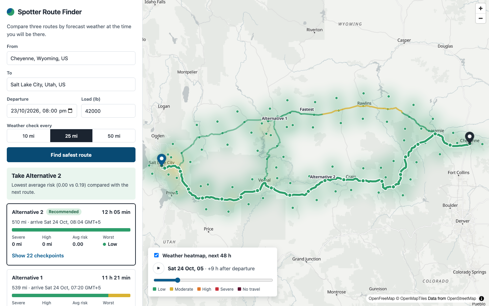

# Spotter Route Finder

Weather-aware truck routing. Enter an origin, a destination, a departure time and a load weight.
The app builds three route options, checks the forecast at each checkpoint for the time the truck
will actually be there, scores the risk, recommends the safest route, and shows everything on a map
with a 0-48 hour forecast heatmap along the trip corridor.

- Backend: Django 5 + Django REST Framework
- Frontend: React + TypeScript + Vite, MapLibre GL for the map
- Data (all keyless): OSRM routing, Photon geocoding, Open-Meteo hourly forecasts



Hosted app: _add URL after deploy_

## How it works

1. **Routes.** OSRM returns the fastest route plus any alternatives. When fewer than three distinct
   routes come back (common on long trips), perpendicular via-points at the trip midpoint are routed
   through to fill the gap. Detours more than 1.5x the fastest distance and routes that share more
   than 90% of their path with another are dropped. If only one or two distinct routes exist, the
   app shows those and says so.
2. **Checkpoints.** Each route is sampled at the start, every 10, 25 or 50 miles, and the end. The
   ETA at each checkpoint is the departure time plus the elapsed time interpolated along the route's
   steps.
3. **Weather.** Open-Meteo hourly forecasts are fetched in batches for every checkpoint, and the
   hour nearest the ETA is used. Wind is sustained 10 m wind in mph, rain is rain plus showers in
   in/hr, snow is snowfall in in/hr.
4. **Risk.** The worst of wind, rain and snow at a checkpoint, after the load rules are applied.
5. **Recommendation.** Fewest Severe miles, then fewest High miles, then lowest average risk, then
   shortest travel time.
6. **Heatmap.** A grid along the corridor (route samples plus lateral offsets) is scored for each of
   the next 49 hours with the same rules and load. The browser loads it once; the slider only
   changes a map paint expression, so scrubbing does not reload data.

## Risk rules as implemented

Bands include their lower bound. The Severe rain and snow bands also include their upper bound
(1.00 in/hr and 3.0 in/hr); No Travel is strictly above.

| Condition | Low | Moderate | High | Severe | No Travel |
| --- | --- | --- | --- | --- | --- |
| Wind (mph) | <25 | 25-34 | 35-44 | 45-54 | >=55 |
| Rain (in/hr) | <0.10 | 0.10-0.25 | 0.25-0.50 | 0.50-1.00 | >1.00 |
| Snow (in/hr) | <0.5 | 0.5-1.0 | 1.0-2.0 | 2.0-3.0 | >3.0 |

Load rules (wind only; they can only raise a level, and "over" means strictly greater):

- wind >= 55 mph: No Travel for any load
- wind 45-54 mph and load > 30,000 lb: No Travel
- wind 35-44 mph and load > 40,000 lb: Severe

### Interpretation decisions

- A checkpoint's level is the worst of its wind, rain and snow levels.
- Each checkpoint owns the miles from itself to the next checkpoint, so miles per level add up to the
  route length. The destination owns none.
- A route containing any No Travel checkpoint is ranked after every route without one. If every
  route has one, no route is recommended.
- Severe miles in the ranking include No Travel miles. Miles are compared to 0.1 and average risk
  to 0.01 so that near-ties fall through to the next criterion.
- Checkpoints whose ETA falls outside the forecast are not scored and are reported as unscored miles;
  they are never assumed Low.
- Times are shown in the browser's local time zone.

## Limitations

- The public OSRM server only has a car profile. Travel times are divided by a truck speed factor
  (default 0.9), so ETAs are an estimate and routes are not restricted by truck height or weight.
- The public OSRM, Photon and Open-Meteo services are fair-use. They are fine for a demo; a
  production deployment should point `OSRM_BASE_URL` and the other URLs at its own or a paid service.
- Forecasts only cover the next 14 days, and the heatmap shows the 48 hours after departure.
- Geocoding is limited to the US, Canada and Mexico.

## Run locally

Backend:

```bash
cd backend
python -m venv .venv && source .venv/bin/activate
pip install -r requirements-dev.txt
cp .env.example .env
python manage.py runserver
```

Frontend:

```bash
cd frontend
npm install
npm run dev        # http://localhost:5173, proxies /api to Django on :8000
```

## Tests

```bash
cd backend && pytest        # rules, sampling, scoring, ranking, providers, API
cd frontend && npm test     # formatting and map data helpers
```

## API

| Method | Path | Purpose |
| --- | --- | --- |
| GET | `/api/health/` | liveness |
| GET | `/api/geocode/?q=` | place suggestions |
| POST | `/api/routes/analyze/` | routes, checkpoints, risk, recommendation |
| POST | `/api/heatmap/` | corridor risk by hour for the slider |

Request body for the POST endpoints:

```json
{
  "origin": {"label": "Chicago, Illinois", "lat": 41.88, "lng": -87.63},
  "destination": {"label": "Houston, Texas", "lat": 29.76, "lng": -95.37},
  "departure": "2026-10-24T14:00:00Z",
  "load_lb": 42000,
  "interval_mi": 25
}
```

Errors always have the shape `{"error": {"code", "message", "fields"}}`.

## Project layout

```
backend/
  domain/      pure Python: rules, geometry, sampling, scoring, ranking (no framework imports)
  services/    routing, geocoding and weather providers, trip analysis, heatmap
  api/         DRF views, serializers, error handling
  tests/
frontend/src/
  api/         typed client
  features/    trip form, results, map, forecast slider
  hooks/, lib/
```

## Deploy

`render.yaml` is a Render Blueprint that builds the frontend and serves it from Django through
WhiteNoise as one web service, so the app and API share an origin.

1. On Render, choose New > Blueprint and select this repository.
2. Apply the blueprint. It generates `SECRET_KEY` and sets `DEBUG=0`; no other secrets are needed
   because every upstream service is keyless.
3. Open the service URL once it reports healthy (`/api/health/`).

The free tier sleeps when idle, so the first request after a pause can take about a minute; the
frontend pings the health endpoint on load to wake it early.
